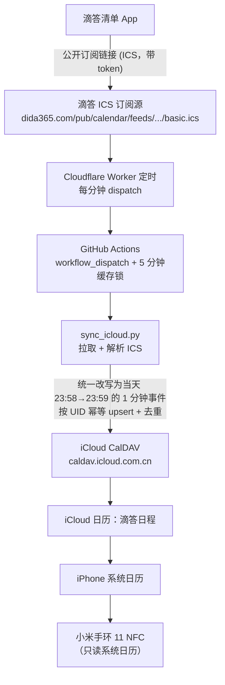
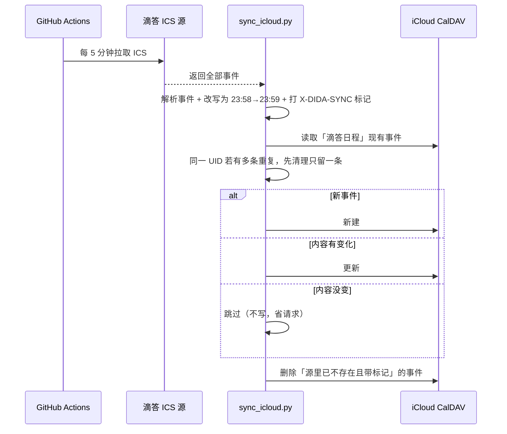

# Dida → iCloud 日历 全自动同步

把滴答清单（Dida365）里的日程，**最快每 5 分钟自动**同步到 iPhone 的 iCloud「滴答日程」日历，让小米手环（只读系统日历）也能看到滴答的待办/日程。Cloudflare Worker 仍按每分钟 dispatch，工作流内部用缓存锁把真正同步限制为每个 5 分钟窗口最多一次，避免过密请求触发限流。

> 核心难点：手环只读 **iPhone 系统日历**，**不读订阅日历 / 第三方日历**。所以不能靠「订阅 ICS 链接」，必须把事件真正写进 iCloud 日历。本项目用 **CalDAV** 写入实现。

---

## 一、整体架构



## 二、一次同步做什么（时序）



## 三、关键设计（为什么这么写）

- **统一改成当天最后一分钟的定时事件**：手环只显示「尚未开始」的事件，**当天的全天事件会被当作已开始而不显示**（隔天的才会显示）。所以无论原事件是全天（`VALUE=DATE`）还是带时间，一律改写成**事件当天 23:58→23:59 的 1 分钟定时事件**，这样当天的事件也算「未开始」，手环当天就能看到。可用环境变量 `FIX_HOUR` / `FIX_MINUTE` / `FIX_DURATION_MIN` 调整（默认 23:58、1 分钟）。
- **先读日历 + 去重，防重复写入**：每次同步**先读取目标日历**；同一 `UID` 若已有**多条**（历史 bug 造成的重复），先清理到只留 1 条，再 upsert。彻底杜绝「越同步越多」的重复事件。
- **幂等 upsert**：每个事件以滴答的 `UID` 为键。内容（标题/起止/RRULE/描述/地点/状态）没变就**跳过不写**，避免每 5 分钟重复产生请求。
- **安全删除**：只删除带 `X-DIDA-SYNC=1` 标记、且源里已经不存在的事件；**绝不碰你手动添加的其它日历事件**（除非显式设置 `CLEAR_FIRST=1` 全量重建，此时目标日历必须专用）。
- **时区归一**：写入是 `+08:00`，iCloud 读回常变成 `TZID=UTC+08:00` 的朴素时间；比较前统一换算成「中国墙钟时间」，否则每次都会被误判为「有变化」。
- **安全退出**：缺 `ICLOUD_*` 密钥时脚本只打印 `[skip]`、返回 0，不会把 Actions 跑红。
- **5 分钟节流 + 临时故障不刷红**：Cloudflare Worker 每分钟 dispatch，但工作流用 `.sync-slot` 缓存锁保证同一个 5 分钟窗口只真正同步一次，避免 1440 次/天的 CalDAV 请求触发 Apple 限流。403/429/网络抖动/偶发 401 重试后仍失败时，只输出 `::warning` 并按成功结束（`SOFT_FAIL_TRANSIENT=1`），避免一次限流风暴发出几十封失败邮件；配置、解析、权限等真错误仍会报红。需要严格失败时把 `SOFT_FAIL_TRANSIENT` 设为 `0`。

## 四、目录结构

```
.
├── sync_icloud.py                 # 核心同步脚本
├── .github/workflows/sync-icloud.yml  # 每分钟由 Cloudflare Worker dispatch，工作流内节流为 5 分钟一次
└── .gitignore
```

## 五、配置（GitHub Secrets）

在你仓库 `Settings → Secrets and variables → Actions` 里配置：

| Secret | 说明 |
|---|---|
| `DIDA_ICS_URL` | 滴答清单的**公开订阅链接**（`https://dida365.com/pub/calendar/feeds/.../basic.ics`，含 token，勿泄露） |
| `ICLOUD_USERNAME` | Apple ID 登录名。注意：**「云上贵州」账号是「手机号+国家码」**（如 `861xxxxxxxxxx`，不带 `+`），不是 QQ 邮箱 |
| `ICLOUD_APP_PASSWORD` | Apple **App 专用密码**（appleid.apple.com → 登录与安全 → App 专用密码） |
| `ICLOUD_CALDAV_URL` | 服务器：中国大陆「云上贵州」账号用 `https://caldav.icloud.com.cn/`；国际账号用 `https://caldav.icloud.com/` |
| `ICLOUD_CALENDAR` | 目标日历名，默认 `滴答日程`（不存在会自动创建） |

## 六、手动运行 / 调试

```bash
# 仅解析、不连 iCloud（校验 ICS 转换是否正确）
python sync_icloud.py --dry-run

# 正式跑一次（需先 export 上面 5 个环境变量）
python sync_icloud.py
```

也可在 Actions 页面点 **Run workflow** 手动触发；默认也受 5 分钟节流，勾选 `force` 可跳过节流立即同步。

## 七、已知限制

- 小米手环官方限制：**只显示未来 7 天内、且尚未开始**的事件。因此本脚本把每个事件都放到它当天 23:58 这一分钟（见「关键设计」），保证当天的事件在当天也算「未开始」而能显示；更远的日程会随日期临近自动出现。
- 事件在**当天 23:58 之后就变成「已开始/过去」**，会从手环的待办里消失（符合真实时间，属预期行为）。
- 手环侧需在 **小米运动健康 App → 设备 → 打开「同步事件」** 并授予日历/通知权限。
- 同步延迟约 5 分钟（Cloudflare Worker 每 5 分钟一次）+ 手机日历同步时间。

## 八、常见问题排查

| 现象 | 排查 |
|---|---|
| Actions 报 `AuthorizationError / Unauthorized` | 若**持续**出现：用户名/服务器不对——云上贵州账号用「手机号+86」+ `caldav.icloud.com.cn`；若**偶发**：多半是 iCloud 限流/风控（同一密码过几分钟又能好），脚本已会自动冷却重试 |
| 每次都「更新」不「跳过」 | 时间/时区表示不一致，检查 `signature()` 的时区归一逻辑 |
| 手环看不到 | 确认事件在 iCloud「滴答日程」里、小米运动健康已开「同步事件」、事件在 7 天内 |
| Actions 偶发 failure，日志是 `Failed to resolve` / `Read timed out` / `RateLimitError`(429) / `403 Forbidden` | 网络抖动、滴答或 iCloud 限流：脚本会自动重试 3 次（网络类 3s/8s 退避，403/429 按服务端 `Retry-After` 或 15s/45s 冷却，401 类冷却 20s/45s）；重试后仍失败时默认只留 warning、不把 run 跑红，所以不应再收到失败邮件。若想严格报错，把 `SOFT_FAIL_TRANSIENT` 设为 `0` |
| 仍收到 GitHub Actions 失败邮件 | GitHub 的邮件是「每个失败 run 一封」，不是项目代码能完全控制的（平台 `startup_failure` 也会发）。到 https://github.com/settings/notifications → System → Actions 选择「Only notify for failed workflows」仍会逐封发；要彻底安静请选「Don't notify」 |
